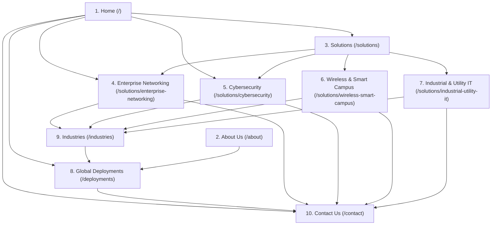

# Orva Networks 10-Page Enterprise Sitemap & Information Architecture

**Project:** Orva Networks Website Redesign  
**Requirement:** Exactly 10 Main Pages  
**Design Reference Inspiration:** Infoblox Enterprise UX  
**Version:** 1.0  

---

## 1. Master Sitemap & URL Structure

The entire 43+ legacy service/industry catalog is streamlined into **exactly 10 high-impact enterprise pages**. Each page serves as a comprehensive, authoritative hub designed to drive technical engagement and sales conversion:

| # | Page Name | Route / URL | Primary Purpose & Strategic Function |
| :-: | :--- | :--- | :--- |
| **1** | **Home** | `/` | The enterprise flagship: high-impact Infoblox-inspired hero, defense client proof, interactive solution matrix, bento value pillars, and primary conversion funnels. |
| **2** | **About Us** | `/about` | Corporate history (Est. 2008, Bangalore), leadership, engineering credentials, mission, core values, and defense/public-sector credibility. |
| **3** | **Solutions Overview** | `/solutions` | Master solutions directory organizing all network, security, wireless, and industrial infrastructure capabilities into a coherent architectural roadmap. |
| **4** | **Enterprise Networking** | `/solutions/enterprise-networking` | Core routing, high-density switching, data center LAN/WAN, structured cabling, server virtualization, and resilient hybrid storage. |
| **5** | **Cybersecurity** | `/solutions/cybersecurity` | DNS defense, Network Access Control (NAC), Zero Trust enforcement, next-gen firewalls, threat telemetry, and compliance defense. |
| **6** | **Wireless & Smart Campus** | `/solutions/wireless-smart-campus` | Wi-Fi 6/6E high-density wireless, campus mesh, IP telephony (VoIP/PBX), AV conferencing, and IoT sensor integration. |
| **7** | **Industrial & Utility IT** | `/solutions/industrial-utility-it` | Operational Technology (OT), SCADA/PLC segmentation, ruggedized networking, energy telemetry, and edge computing. |
| **8** | **Global Deployments** | `/deployments` | Case studies, engineering statistics, defense deployment spotlights (ISRO, BEL, BHEL, BEML), and uptime reliability records. |
| **9** | **Industries** | `/industries` | Vertical-specific solutions matrix covering Aerospace & Defense, Energy & Utilities, Healthcare, Manufacturing, Smart Warehousing, and Retail. |
| **10** | **Contact Us** | `/contact` | Multi-channel consultation booking, enterprise RFP submissions, Bangalore headquarters details, direct telephony, and inquiry forms. |

---

## 2. Navigation Hierarchy

```
[Top Utility Bar]
├── Phone: 080-41161040 (Click to call)
├── Email: info@orvanetworks.com (Click to email)
└── Location: Bangalore, India

[Main Header Navigation]
├── 1. Home (/)
├── 2. Solutions (/solutions) [Hover triggers Mega-Menu]
│   ├── Enterprise Networking (/solutions/enterprise-networking)
│   ├── Cybersecurity (/solutions/cybersecurity)
│   ├── Wireless & Smart Campus (/solutions/wireless-smart-campus)
│   └── Industrial & Utility IT (/solutions/industrial-utility-it)
├── 3. Industries (/industries)
├── 4. Global Deployments (/deployments)
├── 5. About Us (/about)
└── [CTA Button] "Request Consultation" -> (/contact)

[Footer Navigation Matrix]
├── Column 1: Core Solutions (/solutions, /solutions/enterprise-networking, /solutions/cybersecurity, /solutions/wireless-smart-campus, /solutions/industrial-utility-it)
├── Column 2: Industry Verticals (/industries -> Defense, Energy, Healthcare, Industrial, Logistics)
├── Column 3: Proof & Validation (/deployments, /about, Client Roster)
├── Column 4: Company & Contact (/about, /contact, Careers)
└── Newsletter Subscription Bar
```

---

## 3. Legacy Catalog Consolidation (Preserving 43+ URLs into 10 Pages)

To maintain search engine authority and consolidate content depth, legacy service URLs map into the 10 core pages as follows:

| Target Page (1 of 10) | Consolidated Legacy Pages & Topics Covered |
| :--- | :--- |
| **1. Home (`/`)** | `/`, `/company` summary, `/Home/SendNewsLatter` |
| **2. About Us (`/about`)** | `/page/about-us`, `/company`, corporate credentials, team capabilities |
| **3. Solutions (`/solutions`)** | `/services`, `/services/custom-industry-solutions`, `/services/ai-solutions`, `/services/analytics-reporting` |
| **4. Enterprise Networking (`/solutions/enterprise-networking`)** | `/services/networking-solutions`, `/services/server-solutions`, `/services/storage-solutions`, `/blog/future-ready-networking` |
| **5. Cybersecurity (`/solutions/cybersecurity`)** | `/services/security-solution`, `/services/dns-filtering-protection`, `/services/network-access-control`, `/services/end-to-end-security`, `/blog/how-secure-is-your-network` |
| **6. Wireless & Smart Campus (`/solutions/wireless-smart-campus`)** | `/services/wireless-solutions`, `/services/telephony-solutions`, `/services/av-solutions`, `/services/video-conferencing`, `/services/smart-device-integration`, `/services/iot-network-design` |
| **7. Industrial & Utility IT (`/solutions/industrial-utility-it`)** | `/services/ot-solutions`, `/services/cloud-edge-computing`, `/services/cloud-dashboard-remote-management`, `/blog/edge-vs-cloud`, `/blog/real-world-iot-use-cases` |
| **8. Global Deployments (`/deployments`)** | Case studies for ISRO, BHEL, BEL, BEML, Cisco, project metrics, and uptime proof |
| **9. Industries (`/industries`)** | `/industries`, `/industries/corporate-smes`, `/industries/retail`, `/industries/healthcare-...`, `/industries/manufacturing-...`, `/industries/logistics-...`, `/industries/energy-utilities`, `/industries/smart-infrastructure-...` |
| **10. Contact Us (`/contact`)** | `/contact-us`, `/careers` application routing, request a quote endpoints |

---

## 4. Internal Linking & Flow Architecture



### Key Navigation Flows:
1. **Executive Buyer Flow:**  
   `Home` -> `Global Deployments (Trust & Stats)` -> `Solutions Overview` -> `Contact Us`.
2. **Technical Architect Flow:**  
   `Home` -> `Mega-Menu (Cybersecurity / Networking)` -> `Deep Architecture Page` -> `Industries (Compliance Specs)` -> `Contact Us`.
3. **Defense / Enterprise Procurement Flow:**  
   `Home` -> `About Us (Bangalore HQ, Est. 2008)` -> `Global Deployments (ISRO/BEL Proof)` -> `Contact Us`.
